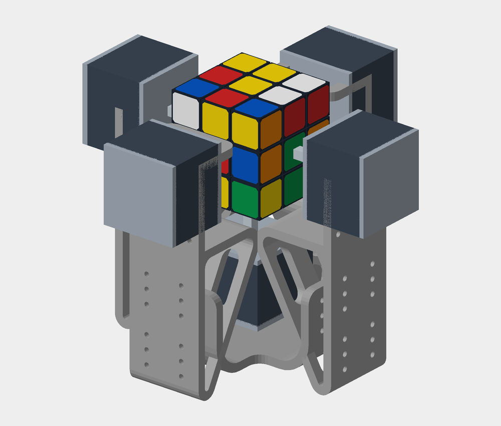
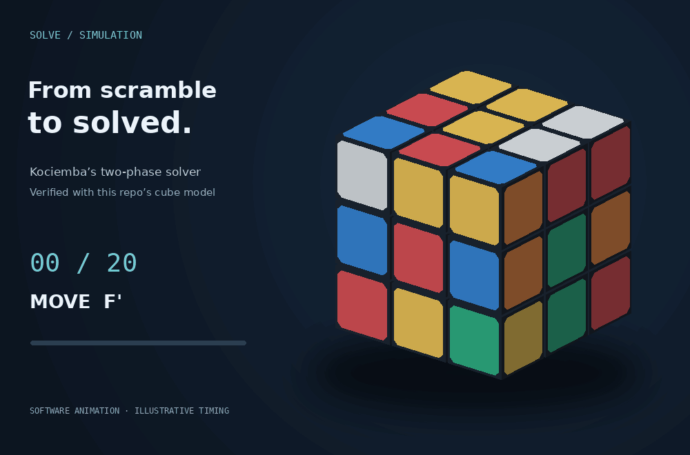
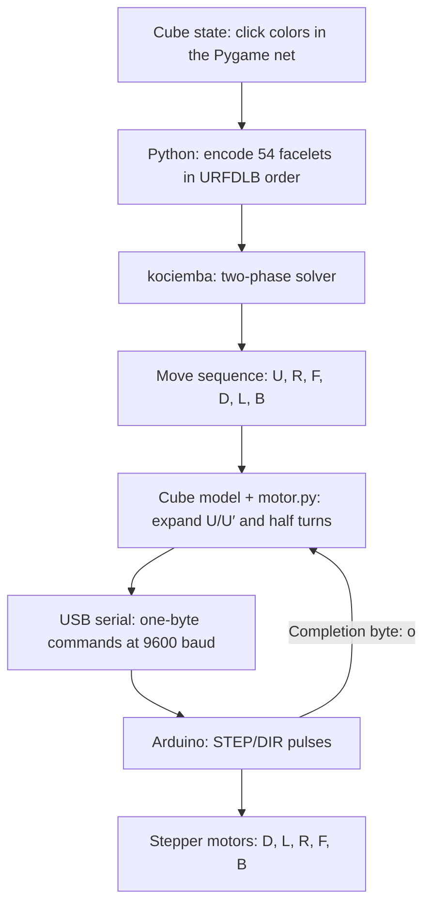
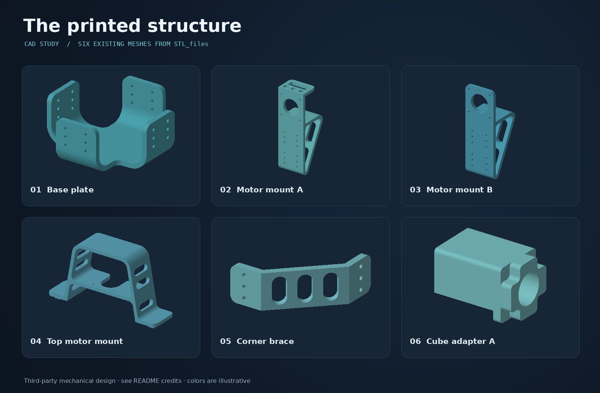

# Rubik’s Cube Robot

**A 2024 project built with my brother: a printed frame, Arduino-controlled stepper motors, and Python software that turns a scrambled cube into a sequence of physical moves.**



*Plain CAD render from the included printed-part meshes. Assembly placement and motor bodies are approximate; this is not a photograph of the build.*

My brother found the existing mechanical design, and we built the robot together. I wrote the Arduino stepper-control firmware and adapted the Python software for our hardware. The Python GUI and cube code build on earlier work credited to Kenneth Hung; the solving algorithm comes from the `kociemba` library. The mechanical design and the underlying solving algorithm are credited to their original creators below.

The interesting constraint: **the controller drives D, L, R, F, and B directly, but cannot turn U directly.** Instead, the Python motor layer realizes U and U′ through sequences of the five available face turns.

## A simulated solve



*A real solution computed by `kociemba`, verified against this repository’s cube model, and rendered as a software animation. Animation speed does not represent the physical robot’s solve time.*

The exact scramble, solution, and verification result are saved in [solve-sequence.json](docs/images/solve-sequence.json). There are no photographs or recordings of the 2024 build in this repository.

## How it works



### Cube input and solving

`main.py` displays a flat cube net in Pygame. Clicking a sticker cycles its color; there is no camera or automatic color detection. The expected face centers are fixed:

| Face | U | R | F | D | L | B |
| --- | --- | --- | --- | --- | --- | --- |
| Color | Yellow | Green | Red | White | Blue | Orange |

`solve()` flattens the faces in **U, R, F, D, L, B** order and calls `kociemba.solve()`. This library implements Herbert Kociemba’s two-phase algorithm and returns standard notation such as `R U′ F2`. It finds short solutions without guaranteeing the shortest possible solution. See the [library documentation](https://github.com/muodov/kociemba).

`execute_steps()` interprets that notation. A `2` suffix becomes two quarter turns; an apostrophe selects the inverse turn. `rubics_cube.py` updates the virtual cube and calls the corresponding function in `motor.py`.

### Turning U without a U drive

Let `A = R L F2 B2 R′ L′`. The motor layer sends:

| Logical move | Physical sequence | Serial bytes |
| --- | --- | --- |
| U | A D A | `RLFFBBrlDRLFFBBrl` |
| U′ | A D′ A | `RLFFBBrldRLFFBBrl` |

Each sequence has 17 physical quarter turns. Both have been checked against the cube model and produce the corresponding U/U′ permutation. A U2 therefore expands to 34 commands. The move count printed by the GUI counts logical quarter turns rather than all physical motor commands.

### Serial protocol

Python opens the port configured in `motor.py` at **9600 baud**. Commands are single ASCII characters, with no newline:

| Command | Action |
| --- | --- |
| `D`, `L`, `R`, `F`, `B` | Corresponding clockwise quarter turn |
| `d`, `l`, `r`, `f`, `b` | Corresponding counterclockwise quarter turn |
| `o` from Arduino | Motor command completed |

The firmware sets direction, emits **50 step pulses**, waits 500 ms, and acknowledges completion. Fifty pulses correspond to a quarter turn only with the appropriate motor, gearing, and driver step configuration.

Python waits up to three seconds for a response before sending the next command. The current implementation logs missing replies and continues; it does not validate that the reply is `o`, retry a move, or recover the physical cube state.

## Hardware

| Component | What is documented here |
| --- | --- |
| Arduino-compatible controller | Editor configuration targets an **Arduino Uno** (`arduino:avr:uno`) |
| Stepper motors | Five independently driven faces in the committed firmware: D, L, R, F, B |
| STEP/DIR motor drivers | One channel per driven face; model and driver configuration were not recorded |
| Motor power supply | Must match the actual motors and drivers; original voltage/current specifications were not recorded |
| 3×3 cube and adapters | Cube center adapters are included among the mechanical files |
| Printed structure | Base, motor mounts, braces, sleeves, and other parts in [`STL_files/`](STL_files/) |
| Computer and USB cable | Runs the Python GUI and connects to the Arduino |
| Wiring and fasteners | Required for the chosen mechanical assembly and electronics |

The mechanical file set also contains a top motor mount and parts with six-motor quantity labels. That file set describes more than the five-drive control path implemented here.



*The existing third-party meshes, rendered individually. G-code is deliberately excluded: slice the STL/3MF files for your own printer and material.*

### Firmware pin assignments

| Face | STEP | DIR |
| --- | --- | --- |
| D | 4 | 5 |
| L | 11 | 10 |
| R | 7 | 6 |
| F | 3 | 2 |
| B | 9 | 8 |

**Check the wiring before powering the motors:** the sketch also defines `MOTOR_ENABLE` as pin **2**, sharing it with `MOTOR_FRONT_DIR`. The intended enable wiring is not documented. Resolve this against your actual drivers before connecting their enable inputs; the assignments above reproduce the existing code.

## Setup and run

### 1. Install the Python dependencies

Python **3.11 or 3.12** is a reasonable starting point; the documented software checks used 3.12.

```bash
git clone https://github.com/oiver12/Rubics-Cube-Solver.git
cd Rubics-Cube-Solver
python3 -m venv .venv
source .venv/bin/activate
python -m pip install -r requirements.txt
```

On Windows, activate the environment with `.venv\Scripts\Activate.ps1` in PowerShell. If installation of `kociemba` needs compilation, install the compiler and libffi development tools described in its [installation instructions](https://github.com/muodov/kociemba#installation).

### 2. Choose display-only or hardware mode

In [`motor.py`](motor.py), choose:

```python
sendMode = False  # Display-only: no serial connection or motor commands
```

Or use `sendMode = True` for the robot and edit the `serial.Serial(...)` port to match your Arduino: `/dev/ttyACM0` on the original Linux configuration, another `/dev/ttyACM*` or `/dev/ttyUSB*` device on Linux, `/dev/cu.usbmodem*` on macOS, or a `COM` port on Windows. The baud rate must stay at 9600 on both ends.

**Hardware mode is enabled by default.** The program opens serial while importing `motor.py`; without a matching device it will fail before displaying the GUI. Close any serial monitor before running Python, and allow the Arduino to finish resetting after a connection opens.

### 3. Upload the firmware for hardware mode

Open [`Rubics-Cube-Solver.ino`](Rubics-Cube-Solver.ino) in the Arduino IDE. If prompted to place the sketch inside a folder named `Rubics-Cube-Solver`, allow the IDE to create it. Select your actual board and port, check the pin assignments and driver settings above, then upload. No additional Arduino library is used by the sketch.

### 4. Start the application

```bash
python main.py
```

For a physical solve, orient the cube to match the fixed center colors, and click each sticker in the net until the display matches the cube. Preserve the center colors and each face’s orientation as shown by the net. Click **start** to solve.

The face buttons execute moves, and **Scramble** performs 25–30 random turns using the five directly driven faces. **With hardware mode enabled, both the face buttons and Scramble move the robot.** In display-only mode, use Scramble and start to explore the software without hardware.

Invalid color entries or impossible cube states can raise a solver error; the original GUI does not provide a validation dialog. The model and physical cube must stay synchronized throughout a hardware session.

## Repository map

| Path | Purpose |
| --- | --- |
| `main.py` | Pygame event loop, facelet encoding, solver call, move execution |
| `rubics_cube.py` | Cube state, face permutations, graphical updates, motor calls |
| `motor.py` | Serial connection, individual commands, U/U′ expansion |
| `Rubics-Cube-Solver.ino` | Arduino motor timing, pin assignments, serial acknowledgements |
| `rectangle.py`, `square.py`, `button.py` | GUI primitives |
| `STL_files/` | Existing mechanical STL/3MF files |
| `docs/images/` | Renders, solve animation, sequence data, and media checklist |
| `scripts/render_media.py` | Reproducible local CAD and cube rendering without serial access |

There is no `solver.py` source in this checkout. The previously tracked compiled cache was removed; the active solving path is in `main.py`.

## Recreate the renders

```bash
python -m pip install -r scripts/requirements-media.txt
python scripts/render_media.py
```

The script reads the existing binary STL meshes, renders an illustrative five-drive layout and a parts gallery, computes a fixed scramble’s solution, and checks that the actual cube model reaches the solved state. It loads the cube class without importing `motor.py`, so it never opens a serial port. The GIF shows logical face turns; U/U′ are animated directly for readability rather than displaying their 17-command hardware expansion.

See the [media checklist](docs/images/README.md) for asset descriptions and optional future replacements.

## Credits and license

- **Build:** built with my brother in 2024. He found the existing mechanical design; we assembled the robot together.
- **Project software contributions:** Arduino stepper-motor control and adaptations to the Python hardware integration, including the U/U′ workaround. The complete Python solver/GUI is not claimed as original work.
- **Python foundation:** [Kenneth Hung’s Rubiks-Cube-Solver](https://github.com/kennethhung863/Rubiks-Cube-Solver). The original attribution in `main.py` is preserved. The exact extent of inherited versus modified Python code has not been fully reconstructed.
- **Solving algorithm:** Herbert Kociemba’s two-phase algorithm, through [muodov/kociemba](https://github.com/muodov/kociemba).
- **Mechanical design:** an existing third-party design, not designed by us. The included part names match [aaedmusa’s Rubik’s Cube Solver tutorial](https://www.instructables.com/Rubiks-Cube-Solver-2/); this is a likely source, not a confirmed provenance record. The original author and redistribution terms for these exact files remain unverified. The files are retained as part of this project’s build archive.

Original project contributions are offered under **GPL-2.0-only**; see [LICENSE](LICENSE). Third-party code and mechanical assets retain their own rights and terms. In particular, no explicit license was found in Kenneth Hung’s upstream repository, and this project’s GPL choice does not relicense that inherited material or the mechanical files. See [NOTICE.md](NOTICE.md) for scope and source details.
